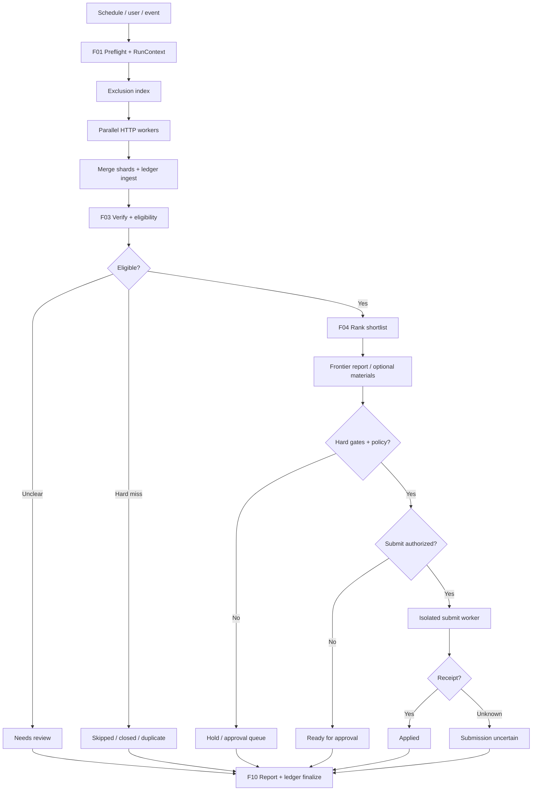
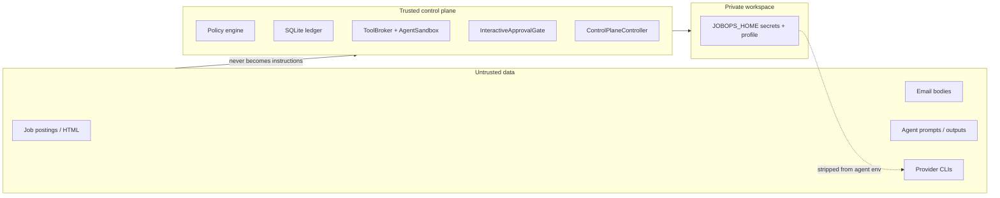

# jobsOps

[](https://github.com/AnkitParekh007/jobsOps/actions/workflows/ci.yml)
[](LICENSE)
[](pyproject.toml)
[](docs/PRODUCTION-READINESS.md)

**Provider-neutral, policy-governed job search operations.** Discovery, verification, ranking, and optional controlled submission run through a deterministic harness — not a single-vendor prompt.

| Status | Meaning |
|---|---|
| **Mergeable foundation** | Reviewed code + CI may land on `main` as an experimental substrate |
| **Not production-ready** | No certified production release; independent audit still required |
| **Submit / outreach** | **Off by default** — never implied by a green CI badge |

> Deep dives live in the [project wiki](docs/wiki/Home.md). Specs and audit rubrics live under [`docs/`](docs/).

---

## What jobsOps is / is not

| Is | Is not |
|---|---|
| A local-first CLI + harness with a policy engine, SQLite ledger, and typed contracts | A private job-search account, resume store, or Claude-only agent |
| Deterministic orchestration first; LLMs only where ambiguity needs them | One giant prompt that invents eligibility, receipts, or scores |
| Provider adapters (`cursor`, `claude_code`, `codex`, `antigravity`, `deterministic`) | A guarantee of interviews, offers, or universal ATS automation |
| Fail-closed gates for submit, outreach, SSRF, and approvals | CAPTCHA/2FA bypass or ToS-exempt scraping |

Private candidate facts live under `JOBOPS_HOME` (OS Application Support / XDG), **outside** this repository. Never commit resumes, cookies, tokens, or real search history.

---

## Architecture at a glance

Logical frontiers (F01–F10) are capabilities, not forty persistent LLM processes. Predictable work stays in deterministic services.



Harness path (`./run` / `jobops run`):

```text
context → exclusion → workers → merge → verify → rank → frontier → validate
  → report_enrich → sheets/drive (offline plans) → ledger_finalize
```

### Trust boundaries



See [Architecture wiki](docs/wiki/Architecture.md) and [docs/ARCHITECTURE.md](docs/ARCHITECTURE.md).

---

## Frontiers overview (F01–F10)

High-level capability map. Implementation depth varies by phase — check [Roadmap & readiness](docs/wiki/Roadmap-and-Readiness.md) before claiming a frontier is complete.

| Frontier | Role | Typical outputs |
|---|---|---|
| **F01** Context & State | Profile, preferences, locks, run context | `RunContext` |
| **F02** Discovery | Bounded HTTP workers, provenance, dedupe | `DiscoveredJob[]` |
| **F03** Verification | Availability, requirements, sponsorship uncertainty | `EligibilityDecision` |
| **F04** Intelligence | Fit / ATS / opportunity signals → shortlist | `RankedOpportunity` |
| **F05** Application | Research, materials, form prep, gated submit | `ApplicationPackage`, receipt |
| **F06** Outreach | Contact research + **drafts only** unless send gated | `OutreachDraft` |
| **F07** Pipeline | Inbox outcomes, interview/deadline signals | `OutcomeEvent` |
| **F08** Learning | Cohort analysis → **proposals**, not silent policy edits | `PolicyProposal` |
| **F09** Quality | Schema, truth, materials, regression gates | `EvalResult` |
| **F10** Operations | Tracker sync plans, artifacts, report, reliability | `RunReport` |

---

## Safety and policy gates

| Gate | Default / behavior |
|---|---|
| Live submit | **Off** — needs `JOBOPS_ALLOW_SUBMIT=1`, `JOBOPS_ENABLE_LIVE_SUBMIT=1`, and `SUBMIT_AGENT=1` plus authorize checks |
| Outreach send | **Off** — `JOBOPS_ENABLE_OUTREACH_SEND` defaults to `0`; drafts ≠ send |
| Daily submit cap | Enforced via atomic SQLite reservations; missing reservation ⇒ no authorize |
| Approval | Interactive TTY confirmation; forgeable markers rejected |
| Control plane | Explicit `jobops control-plane provision` only — `init` / `approve` never install privilege |
| SSRF | `safe_http_fetch` with URL validation + connect-time IP pin |
| Missing eligibility / sponsorship evidence | **Needs review**, never implicit Eligible |
| Fail-closed | CAPTCHA/2FA, unknown auth, provider refusal, inconsistent state → stop |

Full matrix: [Security & Threat Model](docs/wiki/Security-and-Threat-Model.md), [docs/THREAT-MODEL.md](docs/THREAT-MODEL.md).

---

## Quick start

Requires Python **3.10+**. Commands below match the installed CLI (`jobops` entry point → `jobops.cli:main`) and `./run` harness.

```bash
python3 -m venv .venv
source .venv/bin/activate          # Windows: .venv\Scripts\activate
python -m pip install -e ".[dev]"

jobops init                        # private JOBOPS_HOME workspace + profile
jobops doctor                      # workspace, runtimes, defaults

# Non-mutating plan (no harness, no ledger writes)
jobops run --workflow discovery --preview

# Harness runs with submit/outreach forced off; local state may still update
jobops run --workflow discovery --dry-run

jobops report
# or: ./run
```

Evidence HMAC must be provisioned (`JOBOPS_EVIDENCE_SECRET` or `JOBOPS_HOME/secrets/evidence_hmac.key`) — there is **no** fallback secret. See [CLI & Runtime](docs/wiki/CLI-and-Runtime.md).

### Runtime adapters

```bash
export JOBOPS_RUNTIME=auto   # auto | cursor | claude_code | codex | antigravity | deterministic
```

The harness never passes unrestricted `--force` / `--trust`. Deterministic mode works without any AI provider configured.

---

## Technical notes

| Topic | Where |
|---|---|
| Typed handoff envelope + artifact schemas | [`contracts/`](contracts/) — see [Contracts & Schemas](docs/wiki/Contracts-and-Schemas.md) |
| SQLite ledger / outbox / locks / reservations | `state/jobops.db` (or `JOBOPS_DB`); private profile under `JOBOPS_HOME` |
| Eval suites E01–E12 | Targets in [docs/CONTRACTS-AND-EVALS.md](docs/CONTRACTS-AND-EVALS.md); [Eval Suites wiki](docs/wiki/Eval-Suites.md) |
| Provider compatibility | [docs/RUNTIME-CAPABILITIES.md](docs/RUNTIME-CAPABILITIES.md) |
| `./run` stage contract | [harness-contract.md](harness-contract.md) |
| Production audit rubric (not a certificate) | [docs/PRODUCTION-READINESS.md](docs/PRODUCTION-READINESS.md) |

```bash
python -m pytest -q
```

CI runs pytest with `JOBOPS_ALLOW_SUBMIT=0`, `JOBOPS_ENABLE_LIVE_SUBMIT=0`, and `JOBOPS_ENABLE_OUTREACH_SEND=0`.

---

## Documentation map

| Doc | Purpose |
|---|---|
| [Wiki Home](docs/wiki/Home.md) | Maintainer-grade overview and navigation |
| [AGENTS.md](AGENTS.md) | Agent authority — policy engine decides external actions |
| [docs/USER-GUIDE.md](docs/USER-GUIDE.md) | Install / schedule UX |
| [docs/PRODUCT-SCOPE.md](docs/PRODUCT-SCOPE.md) | Personas, inventory, success metrics |
| [docs/ARCHITECTURE.md](docs/ARCHITECTURE.md) | Frontiers and DAG |
| [docs/ROADMAP.md](docs/ROADMAP.md) | Phased delivery gates |
| [CONTRIBUTING.md](CONTRIBUTING.md) | PR expectations |
| [SECURITY.md](SECURITY.md) | Vulnerability reporting |
| [SUPPORT.md](SUPPORT.md) | How to get help |

---

## Contributing

Read [CONTRIBUTING.md](CONTRIBUTING.md) and open a focused PR. Do not self-merge release claims. Use synthetic fixtures only.

## License

[MIT](LICENSE)
