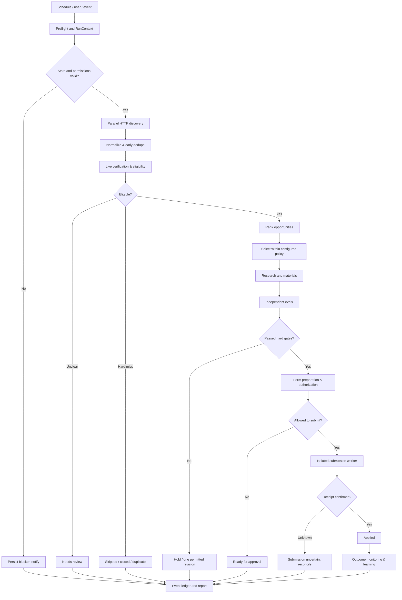

# Architecture: 10 frontiers, 40 logical subagent capabilities

These are **logical capabilities**; do not launch 40 persistent LLM processes. Deterministic services implement the predictable work.

## Control plane
- **Master orchestrator** (deterministic): schedule, event triggers, dependency DAG, leases, budgets, checkpoints, cancellation and recovery.
- **Policy engine** (deterministic): permissions, hard eligibility, authorized account, daily cap, form consent, audit.
- **Agent runtime** (adapter): model/tool invocation, context budgets, schema-output parsing, per-task evidence.
- **Storage**: SQLite WAL (single user initially), outbox and immutable artifacts.
- **Adapters**: public ATS/HTTP, browser, PDF, email, Sheets, Drive, calendar, MCP and optional authenticated API.

## Frontier roster

| Frontier | Logical subagents / services | Output |
|---|---|---|
| F01 Context & State | C01 Profile Reader; C02 Preference Resolver; C03 History Reconciler; C04 Session & Lock Inspector | RunContext |
| F02 Discovery | D01 Region/Lane Planner; D02 ATS Worker; D03 Employer Career Worker; D04 Source Coverage Optimizer | DiscoveredJob[] |
| F03 Verification | V01 Posting Availability; V02 Requirement Extractor; V03 Sponsorship/Work Model Verifier; V04 Duplicate/Policy Classifier | EligibilityDecision |
| F04 Intelligence | I01 Profile Fit; I02 ATS Match; I03 Interview Opportunity Signal; I04 Queue Builder | RankedOpportunity |
| F05 Application | A01 Company Research; A02 Materials Generation; A03 Form Preparation; A04 Submission & Receipt | ApplicationPackage, SubmissionReceipt |
| F06 Outreach | O01 Contact Research; O02 Referral Mapping; O03 Draft Writer; O04 Follow-up Planner | OutreachDraft |
| F07 Pipeline | P01 Inbox Outcome Interpreter; P02 Interview Prep; P03 Deadline Monitor; P04 Offer Comparator | OutcomeEvent |
| F08 Learning | L01 Cohort Analysis; L02 Gap Analysis; L03 Experiment Designer; L04 Policy Proposal | LearningEvent / PolicyProposal |
| F09 Quality | Q01 Schema Gate; Q02 Truth/Eligibility Audit; Q03 Materials/Submission Audit; Q04 Regression/Drift | EvalResult |
| F10 Operations | R01 Tracker Sync; R02 Artifact Manager; R03 Run Report; R04 Reliability Monitor | TrackerSync, RunReport |

## Workflow DAG

Discovery can stream items into verification before a batch finishes; a short ranking stabilization/priority window prevents the first item from automatically consuming a daily submit allowance.

## Concurrency
- Parallelize public HTTP retrieval across bounded source×region lanes; rate-limit per host.
- Run independent company research or document drafts concurrently only for shortlisted roles.
- Serialize authenticated browser submission with exclusive account lock.
- Gmail watcher, learning and reporting run event-driven / separate queues.
- Retry idempotent reads with backoff; do not retry a possible successful submission without reconciliation.

## Storage & idempotency
- Tables: profiles, preferences, jobs, postings, sources, decisions, application_packages, attempts, receipts, contacts, messages, outcomes, tasks, task_leases, locks, outbox, approvals, artifacts, traces, eval_results, policy_versions.
- Stable job identity: employer + ATS requisition ID + region (with URL aliases). Canonical URL alone is insufficient.
- Stable task identity: workflow ID + job ID + task kind + policy version; idempotent UPSERT/event dedupe.
- Atomic state transition + outbox write; external side effects reconciled by receipts and external IDs.
- Every artifact has one authoritative writer and an immutable versioned history.

## Adapter contracts
- ModelProvider: generate / structured output / budget + capabilities.
- AgentRuntime: invoke(agent_spec, input_artifact, tool_scope) -> result + trace.
- ToolProvider: allowlisted tool calls enforced by policy and permissions.
- WorkflowRuntime: enqueue / claim lease / checkpoint / resume / cancel.
- ConnectorAdapter: health / list / fetch / mutate with explicit auth scope.
- NotificationAdapter: deliver local/remote alerts without assuming any provider.

All platform integrations are wrappers around these contracts; the core must run without an editor and deterministic operations must run without a model.

## Failure modes
- Worker failed ≠ source exhausted.
- Source blocked ≠ no matching jobs.
- PDF generated ≠ ATS valid.
- Form filled ≠ submitted.
- Clicked submit ≠ applied.
- Gmail rejection ≠ proof of causal reason.
- Cloud runtime ≠ access to user's Mac, browser, files or keychain.
