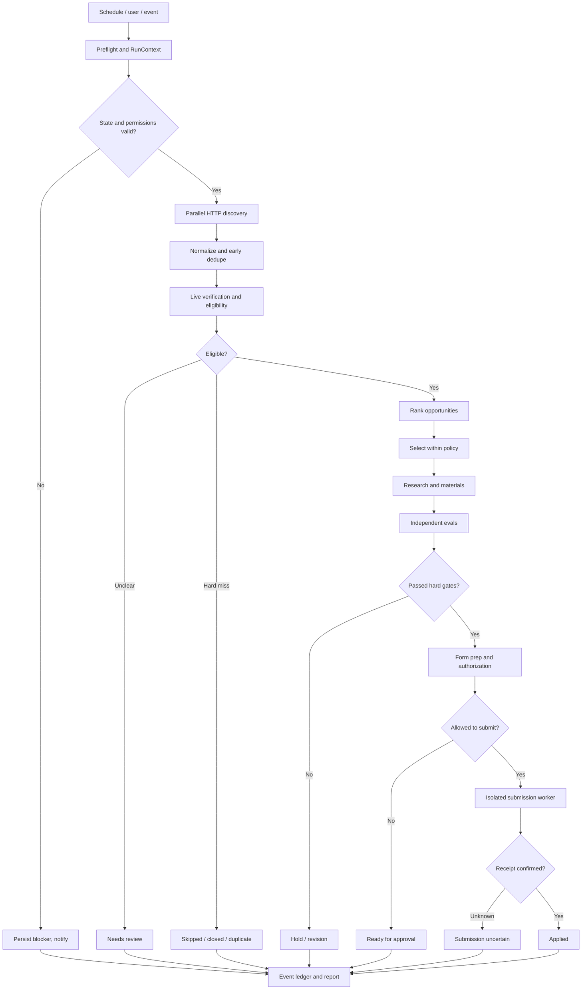

# Architecture

jobsOps separates **control plane** (deterministic) from **agent runtime** (optional adapters). Logical frontiers describe capability boundaries; they are not a mandate to spawn one LLM process per cell.

## Control plane

| Component | Responsibility |
|---|---|
| Master orchestrator | Schedule / triggers, DAG, leases, budgets, checkpoints, recovery |
| Policy engine | Permissions, hard eligibility, daily cap, consent, audit |
| Agent runtime adapter | Model invoke, tool scope, schema parse, traces |
| Storage | SQLite WAL, outbox, immutable artifacts |
| Connectors | HTTP/ATS, browser, PDF, email, Sheets/Drive (many offline-plan only today) |

## Workflow DAG



Harness stages (`./run`):

```text
context → exclusion → workers → merge → verify → rank → frontier → validate
  → report_enrich → sheets_sync → drive_folders → ledger_finalize
```

Pipeline-only skips discovery: `./run --pipeline-only` (requires explicit `PIPELINE_INBOX`).

## Concurrency rules

- Parallelize public HTTP across bounded source × region lanes; rate-limit per host.
- Serialize authenticated browser submission with an exclusive account lock.
- Retry idempotent reads with backoff; **do not** blind-retry a possible successful submit.
- Discovery may stream into verification; ranking uses a stabilization window so the first item does not automatically consume the daily submit allowance.

## Storage and identity

- Stable job key: employer + ATS requisition ID + region (URL aliases alone are insufficient).
- Stable task key: workflow + job + task kind + policy version.
- Atomic state transition + outbox write; external effects reconciled by receipts.

## Failure-mode honesty

| Observation | Must not mean |
|---|---|
| Worker failed / timed out | Source exhausted |
| Source blocked | No matching jobs exist |
| PDF generated | ATS-valid |
| Form filled | Submitted |
| Clicked submit | Applied |
| Cloud runtime available | Access to user's Mac, browser, or keychain |

Canonical detail: [ARCHITECTURE.md](../ARCHITECTURE.md), [harness-contract.md](../../harness-contract.md).
