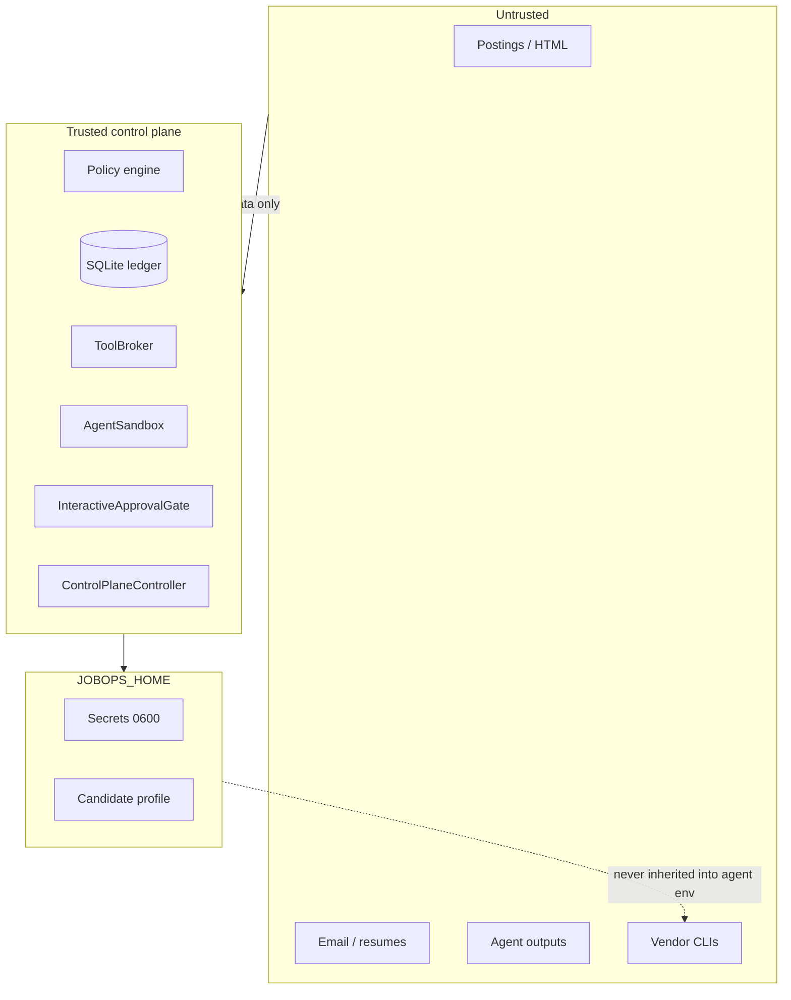

# Security & Threat Model

**Status:** Living audit document for a **mergeable foundation**. Not a certified production release. Live submit and outreach send remain **off by default**.

## Trust boundaries

Motion companion: [Trust boundary visual](../visuals/trust-boundary.html) · [Gallery](../visuals/index.html).

## Assets

- Candidate PII and verified facts in `JOBOPS_HOME`
- Portal cookies / browser profiles (never committed)
- Evidence HMAC key (`JOBOPS_EVIDENCE_SECRET` or `JOBOPS_HOME/secrets/evidence_hmac.key`)
- Control-plane privilege + authority keys
- SQLite ledger (approvals, sessions, locks, reservations, artifacts)

## High-priority mitigations (implemented in foundation)

| ID | Threat | Mitigation |
|---|---|---|
| T1 | Prompt injection widens tools | `ToolBroker` seals allowlists |
| T2 | Agent forges submit consent | HMAC evidence + durable approvals + single-use sessions |
| T3 | Dev/fallback signing secret | Fail closed; no embedded default |
| T4 | SSRF / DNS rebinding | `safe_http_fetch` URL validation + IP pin + peer re-check |
| T6 | Duplicate / uncertain submit | Atomic reservations, identity guard, no auto-retry after uncertain |
| T7 | Accidental live submit | Dual env kill switches default `0` |
| T10 | Self-approval | Exact-type TTY confirmation only in production |
| T11 | Self-minted orchestrator power | Privilege file + signed `AuthorityGrant`; `init` never installs privilege |
| T12 | Unsandboxed AI on submit/outreach | Sensitive roles refuse unsandboxed opt-in |

Residual risks (same-OS-user key theft, vendor CLI not OS-sandboxed, live portal adapters not production-certified) are documented in [THREAT-MODEL.md](../THREAT-MODEL.md) — do not paper over them in README marketing.

## Operator rules

1. Never commit secrets, cookies, or real candidate data.
2. Prefer GitHub private vulnerability reporting ([SECURITY.md](../../SECURITY.md)).
3. Do not enable live submit in CI or unit tests.
4. Treat green CI as mergeability evidence, not production certification.

## Related tests

Adversarial and trust suites under `tests/` include security P0, trust-boundary remediation, authority/session, forge-authorization negatives, URL safety, reservation concurrency, and mock portal E2E. See the threat model for the current file list.
